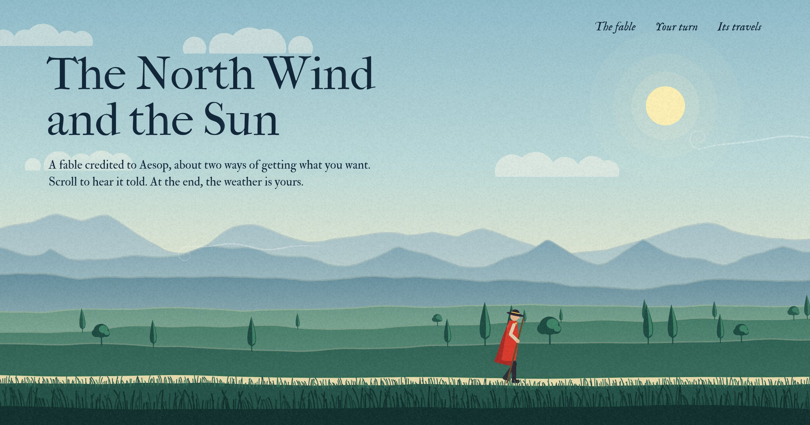

# The North Wind and the Sun

Aesop's fable, retold as a single page. Scrolling tells the story by changing the weather over a landscape; at the end, two sliders hand the wind and the sun to the reader, who can try to get the traveller's cloak off for themselves.



## Run it

It is a static site with no build step and no dependencies. The scripts are ES modules, so serve the folder rather than opening the file directly:

```sh
python3 -m http.server 8000
# then open http://localhost:8000
```

To publish it, turn on GitHub Pages for this repository (Settings → Pages → deploy from the `main` branch, root folder).

## How it works

- `js/scene.js` draws the whole landscape on a canvas, every frame, from two numbers: wind and sun. Sky, mountains, trees, grass, the wind's ribbons and the traveller are all generated; there are no image files.
- `js/main.js` maps scroll position to weather for each passage of the story, runs the sandbox, and passes the scene's colours back to the page so the text and the section below always match the sky and the ground.
- `css/style.css` holds the layout and type. Without JavaScript the page falls back to the full text under a still sky.

The traveller follows one rule: wind makes him hold the cloak tighter, and only warmth with little wind makes him take it off.

People who ask their device for reduced motion get a landscape that holds still and changes only when they scroll or move a slider.

## Credits

Set in the [Fell Types](https://www.iginomarini.com/), digitally reproduced by Igino Marini and used under the SIL Open Font License (see `fonts/OFL.txt`).
